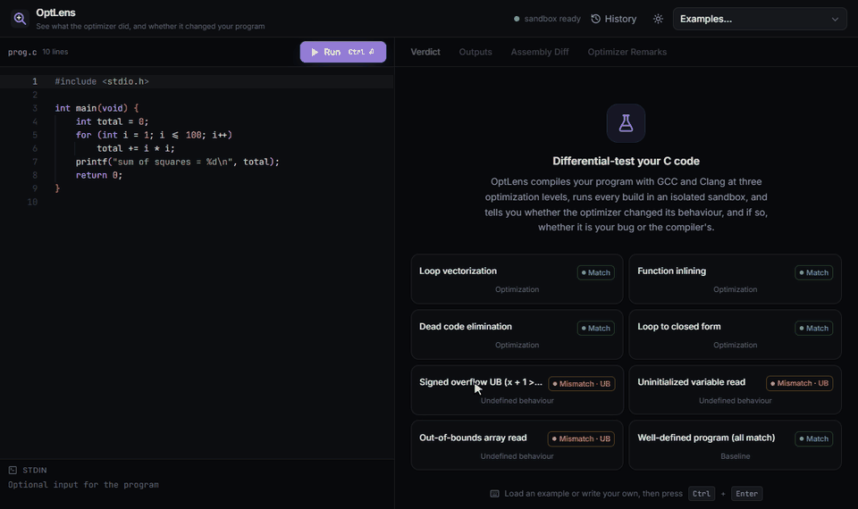
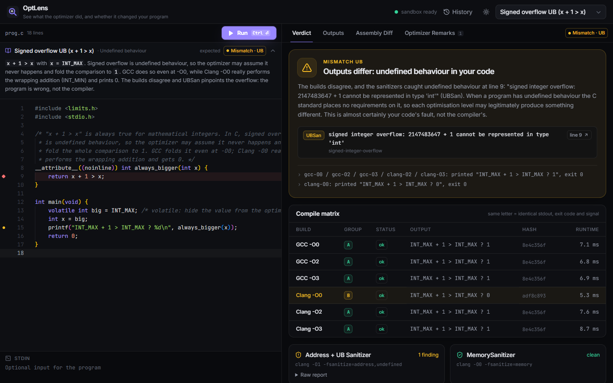
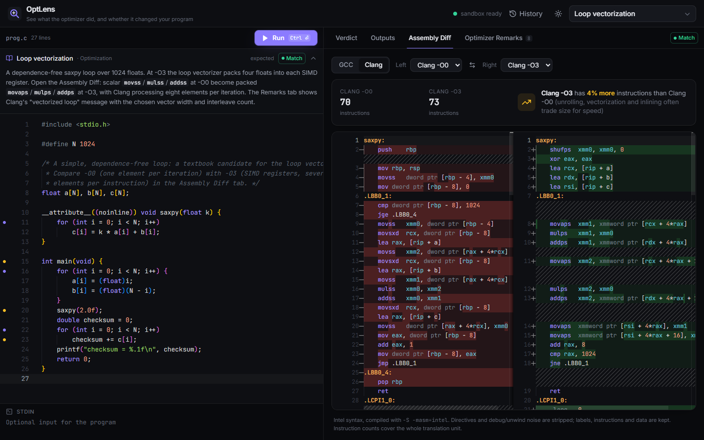
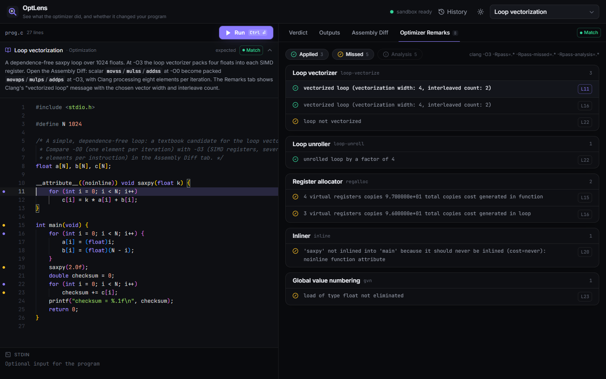
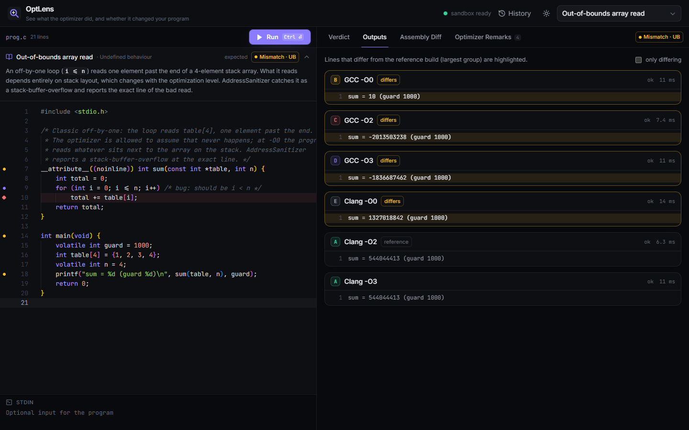
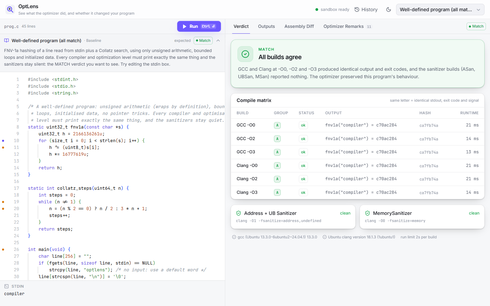
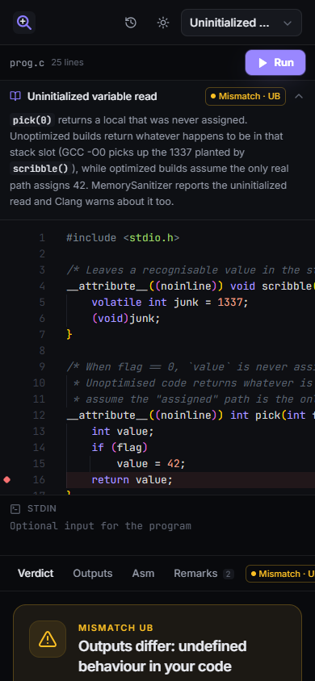
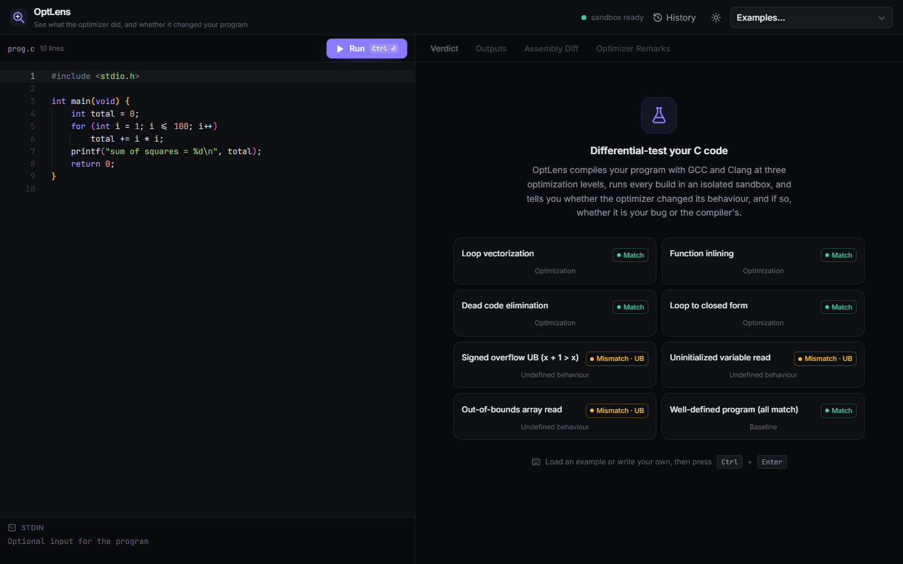
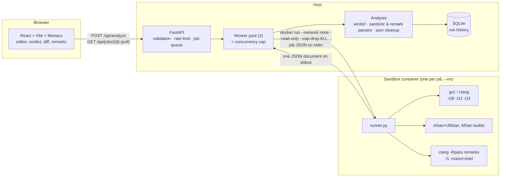

<p align="center">
  
</p>

<p align="center">
  
  
  
  
  
  
  
</p>

**Paste a C program, see what GCC and Clang's optimizers did to it, and find out whether they changed its behaviour, and if so, whether that's your bug or the compiler's.**

<p align="center">
  
</p>
<p align="center"><sub>The signed-overflow example: Clang -O0 wraps around and prints 0, every other build prints 1, UBSan flags line 9, and the assembly diff shows -O3 folding <code>x + 1 &gt; x</code> to <code>mov eax, 1</code>.</sub></p>

OptLens is a small **differential-testing** tool for C compilers. Every submission is compiled with GCC and Clang at `-O0`, `-O2` and `-O3`, every binary is run inside a locked-down Docker sandbox, and the six behaviours are compared. Sanitizer builds (ASan, UBSan, MSan) then decide how to read any disagreement.

## Why

When the same program prints different things at `-O0` and `-O3`, there are two very different explanations:

1. **The program has undefined behaviour.** The C standard places no requirements on such programs, so the optimizer is *allowed* to change the result. Signed overflow, uninitialized reads and out-of-bounds accesses are the usual suspects. The bug is in your code.
2. **The compiler is wrong.** A miscompilation: the optimizer broke a well-defined program. This is what compiler-verification work hunts for.

Differential testing (compare implementations, investigate disagreements) is how tools like Csmith have found hundreds of real GCC and LLVM bugs. The hard part is triage: most disagreements are case 1. OptLens automates that first triage step and explains it in plain English.

## Features

- **Compile matrix:** GCC 13 and Clang 18 × `-O0/-O2/-O3`, each run with wall-clock, CPU, output and file-size limits; stdout, exit code, signal and runtime recorded.
- **Verdicts:**

  | Verdict | Meaning |
  |---|---|
  | `MATCH` | all six builds agree and the sanitizers are clean |
  | `MISMATCH_UB` | builds disagree and a sanitizer (or a UB-specific compiler warning) found undefined behaviour; the report quotes the message and line |
  | `MISMATCH_SUSPECTED_COMPILER_BUG` | builds disagree, sanitizers are clean, and every binary was deterministic across 3 re-runs: a candidate compiler bug, with the disagreeing groups listed |
  | `LATENT_UB` | builds agree, but the sanitizers found UB anyway (the agreement is luck) |
  | `NONDETERMINISTIC` | re-running the *same* binary changes its output, so the optimizer isn't to blame |
  | `COMPILE_ERROR` / `TIMEOUT` / `RUNTIME_ERROR` | handled with specific explanations (e.g. "only -O0 hit the time limit, the faster builds agree") |

- **Flakiness check:** whenever builds disagree, every binary is re-run 3 times before any compiler is blamed.
- **Sanitizers:** a Clang `-O1 -fsanitize=address,undefined` build plus a `-O0 -fsanitize=memory` build (MSan catches uninitialized reads that ASan/UBSan can't). Reports are parsed into structured findings with source lines.
- **Assembly diff:** Monaco side-by-side diff of any two builds (Intel syntax, noise directives stripped) with instruction-count deltas ("Clang -O3 has 62% fewer instructions").
- **Optimizer remarks:** Clang `-Rpass/-Rpass-missed/-Rpass-analysis` at `-O3`, grouped by pass (vectorizer, inliner, LICM, ...); click a remark to jump to its line. Gutter markers in the editor show remark lines and sanitizer findings.
- **8 curated presets** (vectorization, inlining, dead-code elimination, closed-form loops, signed overflow, uninitialized read, out-of-bounds read, a clean program), each verified by the integration tests to produce its stated verdict.
- **Safe by design:** per-job throwaway containers with no network, no capabilities, read-only root, non-root user, seccomp, memory/CPU/PID limits, plus per-IP rate limiting and a bounded worker pool. See [docs/security.md](docs/security.md).
- Run history in SQLite with shareable `?job=<id>` links, dark/light theme, responsive layout.

## Screenshots

<table>
  <tr>
    <td width="50%"><br><sub><b>Verdict</b>: builds disagree and UBSan pinpoints signed overflow on line 9. Clang -O0 is the odd one out.</sub></td>
    <td width="50%"><br><sub><b>Assembly Diff</b>: scalar <code>movss/mulss</code> at -O0 become packed <code>movaps/mulps</code> SIMD at -O3.</sub></td>
  </tr>
  <tr>
    <td width="50%"><br><sub><b>Optimizer Remarks</b>: Clang's decisions grouped by pass; click one to jump to the line.</sub></td>
    <td width="50%"><br><sub><b>Outputs</b>: an out-of-bounds read prints different garbage depending on stack layout; differing lines are highlighted.</sub></td>
  </tr>
  <tr>
    <td width="50%"><br><sub><b>Light theme</b>: a well-defined program, so all builds agree and the sanitizers are clean.</sub></td>
    <td width="50%" align="center">&nbsp;<br><sub><b>Responsive</b> layout and the example gallery.</sub></td>
  </tr>
</table>

## Architecture



The runner inside the container only reports raw facts (outputs, hashes, exit codes, reports, assembly). All interpretation happens in the backend in pure functions, which is what makes the verdict logic unit-testable with recorded fixtures.

## Quick start

**Requirements:** Docker (Docker Desktop on Windows/macOS), Python 3.11+. Node is optional: the UI is built inside Docker.

```bash
# 1. Build the sandbox image (GCC, Clang, sanitizer runtimes) and the web UI image
docker compose --profile build build

# 2. Install and start the API on the host (it launches the sandbox containers)
cd backend
python -m venv .venv
.venv/bin/pip install -e ".[dev]"            # Windows: .venv\Scripts\pip install -e ".[dev]"
OPTLENS_TRUSTED_PROXIES=127.0.0.1,::1,172.16.0.0/12 \
  .venv/bin/python -m uvicorn optlens.main:app --port 8000

# 3. In another terminal, serve the UI
docker compose up -d web
```

Open **http://localhost:5173**, pick an example, press **Ctrl/Cmd+Enter**.

On Windows PowerShell, step 2's last command is:

```powershell
$env:OPTLENS_TRUSTED_PROXIES="127.0.0.1,::1,172.16.0.0/12"; .venv\Scripts\python -m uvicorn optlens.main:app --port 8000
```

With `make` available, `make images venv web` followed by `make api` does the same. Once the images are pulled and built the stack starts in seconds; the first sandbox build downloads roughly 300 MB of Ubuntu packages.

> **Linux note:** containers reach the host through the `docker0` bridge, which doesn't forward to `127.0.0.1`. Start the API with `--host 172.17.0.1` (or `make api API_HOST=172.17.0.1`), which exposes it to local containers but not the LAN.

**Frontend dev mode** (hot reload, needs Node 20): `cd frontend && npm install && npm run dev`. Vite proxies `/api` to `127.0.0.1:8000`.

### Tests

```bash
cd backend
.venv/bin/python -m pytest -q                      # everything (integration tests auto-skip without Docker)
.venv/bin/python -m pytest -q -m "not integration" # unit + API tests only, no Docker needed
```

- `tests/test_verdict.py`: verdict logic on synthetic runner JSON and on fixtures recorded from the real sandbox
- `tests/test_parsers.py`: remark, sanitizer-report, warning and assembly parsers
- `tests/test_api.py`: endpoints with a fake sandbox: validation, rate limiting, queue limits, concurrency cap, docker flags
- `tests/test_integration.py`: real containers: every preset's verdict, sanitizer attribution, timeouts, and that the sandbox is offline, unprivileged and output-capped

To regenerate the README media with the stack running: `python docs/scripts/make_banner.py` for the banner, and `pip install playwright pillow`, then `python docs/scripts/capture_media.py` for the screenshots and GIF. The capture script drives your installed Chrome; pass `--channel msedge` to use Edge.

CI (`.github/workflows/ci.yml`) runs the backend tests, the Docker integration tests and the frontend lint and build.

## API reference

| Method | Path | Description |
|---|---|---|
| `POST` | `/api/analyze` | Body `{"source": str, "stdin"?: str, "preset_id"?: str}`. Returns **202** `{"job_id", "status", "queue_position"}`. 413 on oversize input, 429 when rate-limited, 503 when the queue is full. |
| `GET` | `/api/jobs/{id}` | Job status (`queued`/`running`/`done`/`failed`) and, when done, the full `AnalysisResult`: `verdict` (verdict, title, explanation, evidence, behaviour groups), `builds[]` (status, stdout, hash, runtime, group, determinism, cleaned asm, instruction count), `sanitizers[]`, `remarks[]`, `warnings[]`, `toolchain`. Finished jobs are also served from SQLite after a restart. |
| `GET` | `/api/presets` | The curated examples with title, summary, expected verdict, source, stdin. |
| `GET` | `/api/history?limit=20` | Recent finished runs. |
| `GET` | `/api/health` | Docker reachability, sandbox image presence, workers, queue depth. |

Interactive docs: http://127.0.0.1:8000/docs (FastAPI/OpenAPI).

Configuration is via `OPTLENS_*` environment variables, e.g. `OPTLENS_WORKERS`, `OPTLENS_RATE_LIMIT`, `OPTLENS_RUN_TIMEOUT_S`, `OPTLENS_MEMORY`; see [`backend/optlens/config.py`](backend/optlens/config.py).

## Project structure

```
sandbox/
  Dockerfile          Ubuntu 24.04 + GCC 13 + Clang 18 + sanitizer runtimes, non-root user
  runner.py           compile matrix, limited runs, re-runs, sanitizers, asm, remarks → JSON
  seccomp.json        Docker's default profile + personality(ADDR_NO_RANDOMIZE) for MSan
backend/
  optlens/
    main.py           FastAPI app and endpoints
    sandbox.py        docker run command line and result handling
    jobs.py           async queue + fixed worker pool
    analysis.py       raw runner JSON → AnalysisResult (behaviour groups, determinism)
    verdict.py        the decision procedure
    sanitizers.py     ASan/UBSan/MSan report + UB-warning parsing
    remarks.py        -Rpass remark parsing
    asm.py            assembly cleanup + instruction counting
    ratelimit.py      sliding-window limiter, trusted-proxy client IP
    store.py          SQLite history
    presets/          the 8 example programs + metadata
  tests/              pytest suite + recorded runner fixtures
frontend/
  src/components/     TopBar, CodeEditor, VerdictTab, OutputsTab, AssemblyTab, RemarksTab, ...
  src/monaco.ts       locally bundled Monaco, x86 asm highlighter, themes
  Dockerfile          build with Node, serve with nginx (proxies /api to the host)
docs/security.md      threat model and sandbox details
docs/assets/          README banner (animated SVG), screenshots, demo GIF
docs/scripts/         make_banner.py, capture_media.py (regenerate the media above)
docker-compose.yml    builds the sandbox image, serves the UI
Makefile              convenience targets
```

## Limitations

- **Sanitizers don't see all UB.** Strict-aliasing violations, unsequenced modifications, some evaluation-order and data-race issues pass silently, so `MISMATCH_SUSPECTED_COMPILER_BUG` means *candidate*, not proof. The explanation says so.
- **Single translation unit, C only**, `-std=gnu17`, x86-64 Linux, one GCC and one Clang version (whatever Ubuntu 24.04 ships). No custom flags yet.
- **Programs must be fast:** 2 s per run, 16 KiB of captured output per stream.
- **No test-case reduction:** a real compiler-bug report would need C-Reduce/cvise, which isn't integrated.
- **Remarks come from Clang only:** GCC's `-fopt-info` isn't parsed.
- Jobs take ~5–10 s, dominated by container start-up and ~15 compiler invocations.
- The sandbox is container isolation, not a VM, and a job can tamper with its *own* report. See [docs/security.md](docs/security.md).
- Rate limiting and the job queue are in-memory and per process.

## Prior art

OptLens stands on well-known ideas and tools:

- **[Compiler Explorer](https://godbolt.org)** (Matt Godbolt) is the gold standard for viewing compiler output across many compilers. OptLens's assembly view is a much smaller cousin.
- **[Csmith](https://github.com/csmith-project/csmith)** generates random UB-free C programs for differential testing of compilers and has found hundreds of GCC/LLVM bugs.
- **[C-Reduce](https://github.com/csmith-project/creduce)** shrinks bug-triggering programs to minimal test cases.
- **[Alive2](https://github.com/AliveToolkit/alive2)** formally verifies LLVM optimizations with SMT solving instead of testing.

**How OptLens differs:** it is not a fuzzer, reducer or verifier. It takes *your* program, runs the differential test across compilers and optimization levels in a sandbox, and does the first triage step automatically: UB in your code, nondeterminism, resource limits, or a candidate compiler bug. It explains that triage in plain English alongside the assembly diff and optimizer remarks.

## License

MIT
